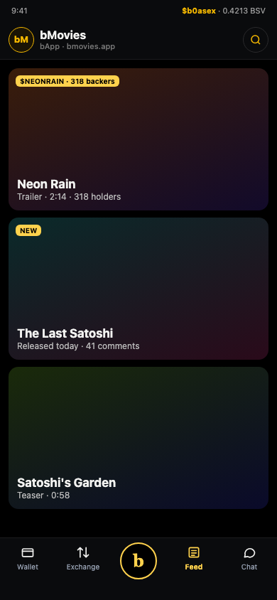

# @bwalletx/connect

Add "Sign in with bWalletX" to a website. Built on the open BRC-100 wallet interface, so every BRC-100 wallet works the same way, with bWalletX first.

The user's wallet signs a one-time challenge from your server with a key derived from its identity key. Your server checks the signature and signs the user in as that identity key. You don't need an API key or an account with us, and nothing passes through bwalletx.com. The only service of ours involved is the encrypted pairing relay (`relay.bwallet.space`), and only when the user signs in from a phone or the web wallet.

The full protocol is described at https://bwalletx.com/connect.md. This package is the same code, packaged.

## Install

```sh
pnpm add @bwalletx/connect
```

### Requirements

- **Node 22 or later** on the server (and for builds): `@bsv/sdk` 4.x requires it. Any current browser.
- **No `@bsv/sdk` needed from you.** Since 0.8.0, connect depends on its own `@bsv/sdk` (^4.0.1) instead of using your app's copy, so your app can stay on any version (1.9, 2.x or 4.x). The wallet clients connect builds itself (in the bWalletX frame over XDM, desktop wallets with `probeLocal`, and Metanet Desktop via `metanetOption()`) are 4.x `WalletClient`s whatever your version: arguments are validated before they reach the wallet, answers are validated (createAction/signAction answers checked against the request), and every XDM call times out after `XDM_RESPONSE_TIMEOUT_MS` (10 minutes) instead of waiting forever. Wallets the page already has (the extension's announcement, `window.CWI`, a phone pairing) are used as they are.
  - App on **4.x**: the package manager shares one copy (pnpm, checked, resolves connect's ^4.0.1 to the app's 4.x, even a pinned 4.0.1). No extra size.
  - App on **1.9 or 2.x**: you get two copies. In a browser bundle connect's copy adds about 417 KB minified (about 125 KB gzipped) on top of yours. If that matters, load the sign-in code lazily (`import('@bwalletx/connect')` on click).
- **Nothing crosses as an `@bsv/sdk` object.** Pass wallets as any BRC-100 wallet: the `Brc100Wallet` type accepts a `WalletInterface` from any `@bsv/sdk` version, or a plain object with the same methods. Everything else goes in and out as strings and byte arrays: txids, hex, BEEF/Atomic BEEF bytes, DER signatures as `number[]`. Don't `instanceof`-check what connect returns against your own `@bsv/sdk` classes.
- Wallets connect hands back (`useBwalletX().wallet`, `SignInResult.wallet`, `findBwalletX()`) are typed as connect's own (4.x) `WalletInterface`. In a codebase typed against 1.9, cast before passing one to 1.9-typed code: 4.x types byte results as `number[] | Uint8Array`, 1.9 as `number[]`.
- `react` 18+ and `next` 14+ are optional peers, only for `/react` and `/next`.

## Next.js quick start (App Router)

Works with bWalletX and any other BRC-100 wallet. Set a session secret (32+ characters) in your environment. There is no default: the routes throw without it.

```sh
# .env.local (never commit it)
BWALLETX_SESSION_SECRET=   # e.g. the output of: openssl rand -base64 48
APP_ORIGIN=https://example.com
```

```ts
// lib/bwalletx.ts
import { createBwalletXAuth, pgStore, signInOrLink } from '@bwalletx/connect/next';
import { query } from './db'; // (sql, params) => Promise<{ rows }>

export const auth = createBwalletXAuth({
  origin: process.env.APP_ORIGIN!,
  store: pgStore({ query }),            // or redisStore({ client: upstash })
  // Optional: link the identity key to your user table.
  onVerified: async (identityKey) => {
    const r = await signInOrLink(identityKey, {
      findUserByIdentityKey: async (k) => (await query('select user_id from wallet_links where identity_key = $1', [k])).rows[0]?.user_id ?? null,
      attach: async (uid, k) => void (await query('insert into wallet_links (user_id, identity_key) values ($1, $2)', [uid, k])),
      createUser: async () => (await query('insert into users default values returning id', [])).rows[0].id,
    });
    return { uid: r.userId ?? undefined };
  },
});
```

```ts
// app/api/bwalletx/challenge/route.ts
import { auth } from '@/lib/bwalletx';
export const POST = auth.challenge;
// app/api/bwalletx/verify/route.ts  → export const POST = auth.verify;
// app/api/bwalletx/logout/route.ts  → export const POST = auth.logout;
// app/api/bwalletx/session/route.ts → export const GET = auth.session;
```

```tsx
// any server component or route handler
const session = await auth.getSession(); // { sub: identityKey, uid?, handle?, paymail?, exp } | null
```

The cookie (`bwx_session`) is `HttpOnly; SameSite=Lax; Secure` (Secure when the origin is https), HMAC-SHA256 signed, 7 days by default (`maxAge`). Both POST routes check the `Origin` header against `origin`. `signSession` / `verifySession` are also exported from `@bwalletx/connect/server` if you want the token without the adapter.

Create the nonce table once (a migration): `pgNonceTableSql()` returns the SQL.

**Hydration warning.** bWalletX for Chrome adds a `data-bwalletx-ext` attribute to `<html>` and `<body>` before React hydrates, so Next.js logs a harmless hydration mismatch. Put `suppressHydrationWarning` on both in `app/layout.tsx`: `<html lang="en" suppressHydrationWarning>` and `<body suppressHydrationWarning>`. It only silences attribute differences on those two elements, not in your components.

**One sheet needs the server too.** The client and the challenge route must both be 0.5.5 or newer: an older `createChallenge` refuses a challenge without an identity key, and the client then falls back to asking for the key first (two wallet sheets).

## React quick start

```tsx
'use client';
import { BwalletXProvider, useBwalletX } from '@bwalletx/connect/react';

export function Providers({ children }: { children: React.ReactNode }) {
  return (
    <BwalletXProvider
      challengeUrl="/api/bwalletx/challenge"
      verifyUrl="/api/bwalletx/verify"
      logoutUrl="/api/bwalletx/logout"
      sessionUrl="/api/bwalletx/session">
      {children}
    </BwalletXProvider>
  );
}

function Account() {
  const { status, identityKey, handle, connect, disconnect, tip } = useBwalletX();
  if (status !== 'connected') return <button onClick={() => connect()}>Connect wallet</button>;
  return (
    <>
      <span>{handle ?? identityKey?.slice(0, 10)}</span>
      <button onClick={() => tip({ to: 'author@example.com', usd: 0.05 })}>Tip 5¢</button>
      <button onClick={disconnect}>Sign out</button>
    </>
  );
}
```

`useBwalletX()` gives `status` (`idle | restoring | connecting | connected | error`), `identityKey`, `handle`, `paymail`, `wallet` (the BRC-100 `WalletInterface`), `walletId`, `signedIn`, `error`, `wallets`, `connect({ walletId? })`, `disconnect()`, `listWallets()`, `pay`, `tip` and `buyToken`.

`connect()` finds wallets and signs in through your routes when `challengeUrl` and `verifyUrl` are set, with **one wallet sheet**: the challenge comes first (no key), then the identity key and the signature are asked for together, and a repeat sign-in on the same site is the signature alone. With bWalletX in the browser there is no chooser at all (0.5.6); without it the chooser opens with "Get bWalletX" first, and another wallet is used only when picked (see "Which wallet signs in"). Nothing touches `window` during render, so the provider is safe in server-rendered pages. After a reload the session comes back from `sessionUrl`, but `wallet` stays `null` until the user calls `connect()` again.

### Drop-in: provider + one element + 3 routes

The official element follows the provider, so one element gives the whole experience: **Sign in with bWalletX** → **Approve in bWalletX…** (with one line: "Sign in: shares only your public identity key, moves no money") → a signed-in badge (bAvatar, $handle or a short key, gold dot) whose menu has **Copy paymail/key** and **Disconnect**. A reload restores the badge from `sessionUrl` with no wallet prompt. A no in the wallet reads "Sign-in cancelled" with **Retry**.

```tsx
<BwalletXProvider challengeUrl="/api/bwalletx/challenge" verifyUrl="/api/bwalletx/verify"
  logoutUrl="/api/bwalletx/logout" sessionUrl="/api/bwalletx/session">
  <BwalletxSignin size="sm" />   {/* in your header; that's all */}
</BwalletXProvider>
```

Your own UI instead: `const { status, identityKey, paymail, handle, label, avatarUrl, error, login, logout } = useBwalletXAccount();` (`status`: `restoring | signed-out | pending | signed-in | error`).

**Upgrade the server too.** The one-sheet order needs a challenge route that accepts no key: `createChallenge` / `createBwalletXAuth` from 0.5.5. Against an older server the browser sees the refusal and falls back to the old order (two sheets) by itself; `challengeNeedsIdentityKey` skips the attempt.

## Payments

Other bCorp apps: use `tip()` for the default Tip button (the same one-sheet tip bWalletX shows on artists, NFTs, chat, Friends and Spaces).

```ts
import { pay, tip, buyToken } from '@bwalletx/connect';

await pay(wallet, { to: 'alice@example.com', sats: 5000, memo: 'Album' }); // paymail
await pay(wallet, { to: '1Abc...', usd: 1 });                              // address; WhatsOnChain rate, or pass usdPerBsv
const r = await pay(wallet, { to: identityKeyHex, sats: 100 });            // BRC-29; r.remittance goes to the recipient
await buyToken(wallet, { token: '$BOASE', amount: 100, quote: (q) => fetch('/api/quote', { method: 'POST', body: JSON.stringify(q) }).then((x) => x.json()) });
```

Each call makes one `createAction`, and nothing is ever retried. Failures throw a `PaymentError` with a `code` (`BAD_REQUEST`, `RESOLVE_FAILED`, `RATE_FAILED`, `WALLET_REJECTED`, `WALLET_ERROR`, `NOT_SUPPORTED`, `INSUFFICIENT_FUNDS`). A wallet with no coins for the fee (0.7.0: the SDK's `WERR_INSUFFICIENT_FUNDS`, also over Metanet Desktop's JSON API, or a wallet's own "insufficient funds") gives `INSUFFICIENT_FUNDS` with `maybeSent: false` and one plain line you can show as is: "Your wallet doesn't have enough to cover this payment and its small network fee. Add a little and try again." (`NO_COINS_TEXT`; `isInsufficientFunds(e)` for your own calls). When `maybeSent` is true, the wallet may already have broadcast the payment, so check before you ask the user again. That includes a call that timed out in the bWalletX frame (`XDM_RESPONSE_TIMEOUT_MS`, 10 minutes, 0.8.0): the sheet may still be open and the wallet can still send it, so reconcile on your server (`verifyPayment`, or your own payment record) before offering a retry, and deliver only after server-side verification. Browsers often can't resolve paymails themselves because of CORS, so pass `resolvePaymail` to do it on your server.

**Verify payments on your server.** A txid or BEEF that comes back to the page is only what the page was told: a
browser extension, a modified page or (before 0.5.2) a parent frame posing as the wallet can return a fake one.
Deliver nothing until your server has checked the payment:

```ts
import { verifyPayment } from '@bwalletx/connect/server';

const r = await verifyPayment({
  tx: body.tx ?? body.txid,                       // Atomic BEEF / BEEF / raw hex, or a txid (fetched from WhatsOnChain)
  expected: [{ address: SELLER_ADDRESS, satoshis: price }], // or { script: hex, satoshis }
  requireSeen: true,                              // status from WhatsOnChain; or status: 'arc', arcUrl, arcApiKey
});
```

Every expected output has to be matched by a different output that carries at least the expected amount. Otherwise `verifyPayment` throws a `PaymentVerificationError` with a `code` (`OUTPUT_MISSING`, `TX_NOT_FOUND`, `NOT_SEEN`, `REJECTED`, `SPV_FAILED`, `BAD_TX`, `NETWORK`). Pass `spv: chainTracker` to check the merkle proofs in a BEEF as well.

## Wallets and the picker

`discoverWallets()` lists everything it can find, with bWalletX first:

- every wallet that announces itself through BRC-100 discovery (bWalletX, Yours, Metanet and others)
- bWalletX in its own app frame (XDM, only from bWalletX's origins)
- a `window.CWI` that nobody announced, under a neutral name ("Browser wallet"); it is never taken for bWalletX
- desktop wallets on localhost ports 3321 and 3301 (only with `probeLocal: true`; prefer `desktopOption()`, below)
- phone pairing (`pairing: pairingModal()`)
- any adapters you add in `extra`

`pairingModal()` returns `PairingOptions` that draw the QR code and match code, so you no longer need your own QR library. On phones and tablets it shows an **Open bWalletX** button (the pairing universal link opens the app) and a web.bwalletx.com fallback instead of a QR; pass `mode: 'qr'` or `'app'` to force one.

### Which wallet signs in (0.5.6)

bWalletX is the default on our sites, and no other wallet may take the sign-in flow:

1. **bWalletX is recognised by its own announcement** (`com.bwalletx.extension`, `space.bwallet.mobile`) or by the bWalletX app frame, never by who holds `window.CWI`. Metanet / BSV Desktop or Yours can set or overwrite `window.CWI`; `discoverBwalletX()` no longer takes it.
2. **bWalletX here → straight to its sheet.** No site chooser. A small **Other wallets** link under the button opens the chooser (phone QR, other browser wallets, desktop wallets).
3. **No bWalletX → the chooser, "Get bWalletX" first**, then what was detected. Another wallet is connected only when the user picks it, even when it is the only one.
4. **No localhost probe on load.** "Use Metanet Desktop or another BRC-100 wallet" in the chooser (0.7.0; was "Desktop wallet") looks on localhost:3321 only when tapped, so Chrome's Local Network Access prompt follows a tap. `desktopOption()` (3321 / 3301) is still exported.

`decideWallet(list, { chooser, picker, walletId, fastPath })` is the rule as a pure function; `runConnect`, `BwalletXProvider` and `<bwalletx-signin>` all use it. `chooseWallet(list)` is the chooser UI (`pickWallet` is the 0.5.5 one, still exported). If your site has its own chooser, call `decideWallet` first and show yours only when it answers `{ reason: 'chooser' }`:

```ts
import { discoverWallets, decideWallet, chooseWallet, pairingModal } from '@bwalletx/connect';

const list = await discoverWallets({ pairing: () => pairingModal() });
const { option, reason } = decideWallet(list);            // bWalletX here → option, no chooser
const chosen = option ?? (reason === 'chooser' ? await chooseWallet(list) : null);
```

`BwalletXProvider fastPath={false}` (or `runConnect({ fastPath: false })`) restores the 0.5.5 picker rule. `connect({ chooser: true })` is the "Other wallets" link. `<bwalletx-signin other-wallets="auto|on|off">` controls the link (auto: shown at lg/md when the element signs in).

### Returning visitors (0.6.0 line, first published in 0.7.0)

After a sign-in the user explicitly picked, the wallet **type** is remembered for the origin (`localStorage['bwx:wallet']`, e.g. `{ "type": "io.yours", "substrate": "injected" }`; never a key). The next tap goes straight to that wallet, with no chooser. On load nothing that could prompt fires: with a live session the provider picks the remembered wallet up by discovery alone, so `pay`/`tip` work after a reload; without one, the next tap connects. If the remembered wallet isn't bWalletX, the element shows **Some features need bWalletX · Switch** (and "Switch to bWalletX" in its menu); `useBwalletX()` exposes `needsBwalletX` and `switchToBwalletX()` for your own UI. Disconnect forgets the choice. Turn it off with `rememberChoice={false}` / `autoConnect={false}` on the provider or `remember="off"` on the element.

### Metanet Desktop and other BRC-100 wallets (0.7.0)

**Use Metanet Desktop or another BRC-100 wallet** · *Metanet Desktop must be running on this computer.* A small link under `<bwalletx-signin>` (lg/md; `metanet="auto|on|off"`), a row in the chooser, `useBwalletX().connectMetanet()` or `runConnect({ metanet: true })`. The same rules as the bChatX door:

1. **bWalletX stays the default.** It is found by its own announcement only; the button's discovery never picks Metanet, remembered or not. No desktop wallet on localhost is picked without its own tap: not by `autoChoice` / `fastPath={false}`, not after `probeLocal`, and not from a remembered 0.6.0 "Desktop wallet" (`isLocalDesktop`).
2. **Pinned, and only on its own tap.** `WalletClient('json-api')` on localhost:3321, never `'auto'` (which would let the bWalletX extension or `window.CWI` answer). A first visit makes no :3321 call on page load.
3. **Remembered:** the wallet type (`bwx:wallet = { "type": "metanet", "substrate": "json-api" }`) and the identity keys known on this origin (`bwx:known-keys`, public keys only). A key counts as known only after your verify route accepted its sign-in (or it matches the server session); a plain connect adds nothing.
4. **Back with Metanet remembered:** one silent attempt per page load, a 2 s window (`trySilentMetanet` / `runSilentMetanet`). It goes on only if Metanet returns an identity key already known here, since whatever answers on :3321 might be another profile or another local process. Otherwise the normal choice, with no error banner and no retry. With a server session, it only attaches the wallet when it holds the session's key.
5. **"Not you? Use another wallet"** (shown while Metanet is remembered) and Disconnect forget the choice; `useBwalletX().forgetWallet()` for your own UI. A sign-in dropped this way lands nobody (`logoutUrl` ends a session its verify already set).
6. **Computers only**, never inside a frame (`metanetOffered()`).
7. **The minimum:** `getVersion`, `isAuthenticated` (never prompts), the identity key, then the sign-in signature, one request at a time. No protocol permission requests at connect.

Nothing on :3321 after a tap shows "We couldn’t reach Metanet Desktop. Open it, then try again."

**`logoutUrl` / `logout-url` is required whenever `verifyUrl` / `verify-url` is set.** "Not you? Use another wallet" and Disconnect end the session the verify route created by POSTing to it; without it a silent Metanet sign-in the person rejected would stay signed in. In development the provider and the element `console.warn` once when it is missing.

**Telemetry.** `onAttempt` (provider prop, `runConnect` option) and the element's `bwalletx-attempt` event report one record per attempt: `{ walletType, substrate, outcome, ms }`. `walletType` is `'bwalletx'` or the other wallet's rdns / option id; `substrate` is how it reached the page (`extension`, `in-app`, `xdm`, `injected`, `window.CWI`, `json-api`, `cicada`, `pairing`, `adapter`); `outcome` is `signed-in`, `connected`, `cancelled`, `rejected`, `not-found` or `error`. No keys, addresses or identity data.

## Migrating from HandCash Connect

1. Keep your HandCash login for now and put it behind the same picker:
   ```ts
   import { handcashAdapter } from '@bwalletx/connect';
   const handcash = handcashAdapter({
     login: () => myExistingHandCashLogin(), // resolves { handle, paymail? } once signed in
     pay: (req) => fetch('/api/handcash/pay', { method: 'POST', body: JSON.stringify(req) }).then((r) => r.json()),
   });
   <BwalletXProvider extraWallets={[handcash]} ... />
   ```
   **This adapter is transitional.** It wraps your own HandCash code; this package does not import any HandCash SDK. HandCash announced BRC-100 support in October 2026. Once that ships, HandCash shows up as an ordinary BRC-100 wallet and you can delete the adapter.
2. Let existing users link their wallet. When someone already signed in with HandCash connects bWalletX, call `signInOrLink(identityKey, { currentUserId, ... })` (or `linkIdentity`) in `onVerified`. This links the identity to their existing account instead of creating a new one. If the identity is already linked to someone else, `IdentityLinkConflictError` turns into a 409 response.
3. Replace HandCash payment calls with `pay` / `tip` / `buyToken`, and check them on the server with `verifyPayment` instead of HandCash payment webhooks.
4. Remove the adapter when your users have moved over.

## The nav wallet control: use only `<bwalletx-button>`

**Use only this element for your site's wallet control. Don't add your own "Get bWalletX" or "Connect" links or buttons next to it.** It renders exactly one thing by state:

| State | Shows |
|---|---|
| No wallet in this browser | **Get bWalletX** (a link: bwalletx.com/extension on desktop Chrome, /iphone, /android, else /get) |
| A wallet here, not connected | **Connect bWalletX** (extension, in-app browser, or a QR to the phone app) |
| Connected | The **$handle chip** (click to disconnect) |

```html
<script src="https://cdn.jsdelivr.net/npm/@bwalletx/connect/dist/bwalletx-connect.global.js"></script>
<header>… <bwalletx-button></bwalletx-button></header>
```

Or `import '@bwalletx/connect/element'`. Attributes: `size` (sm, md, lg), `get-url`, `discover-ms`, `lookup-url`. Events: `bwalletx-connected` `{ identityKey }` and `bwalletx-disconnected`.

**Guard:** there is one per page. A second `<bwalletx-button>` hides itself. Legacy controls inside the same `<header>`/`<nav>` (`[data-bwx-connect]`, `.nav-connect`, `.nav-acct`, links to bwalletx.com/get) are hidden too. Each one hidden logs a console warning. Links in your page content are left alone.

## The button

`<bwalletx-signin>` is the standard "Sign in with bWalletX" button: a web component with no dependencies (Shadow DOM), plus a React wrapper. It is the gold button from bit-sign's sign-in card.

```html
<script src="https://unpkg.com/@bwalletx/connect@0.2.0"></script>
<bwalletx-signin challenge-url="/auth/bwalletx/challenge" verify-url="/auth/bwalletx/verify"></bwalletx-signin>
<script>
  document.addEventListener('bwalletx-signed-in', (e) => location.assign('/'));
</script>
```

With a bundler: `import '@bwalletx/connect/element'` registers the element. In React:

```tsx
import { BwalletxSignin } from '@bwalletx/connect/react';

<BwalletxSignin challengeUrl="/auth/bwalletx/challenge" verifyUrl="/auth/bwalletx/verify" onSignedIn={(d) => console.log(d.identityKey)} />
```

| Attribute | Values |
|---|---|
| `size` | `lg` (default), `md`, `sm`, `icon` |
| `theme` | `gold` (default), `dark`, `light` |
| `label` | `signin` (default), `continue`, `connect` |
| `brand` | `bWalletX` (default), `bWallet` (store edition) |
| `subtitle` | `on`, `off`, or your own text. Default "also works with bWallet" on lg/md |
| `full-width`, `loading`, `disabled` | flags |
| `challenge-url`, `verify-url` | run the sign-in flow on click: POST `{}` (one sheet; `{ identityKey }` on a repeat sign-in), then POST `{ identityKey, nonce, signature }` |
| `session-url`, `logout-url` | restore the signed-in badge on load (no wallet prompt); POST on Disconnect |
| `lookup-url` | paymail lookup for the badge (default pay.bwallet.space; `off`) |
| `stateless` | the pre-0.5.5 plain button: no badge, no pending/error states |
| `state` (+ `identity-key`, `paymail`, `handle`, `avatar-url`, `error`) | drive the states yourself; `<BwalletxSignin>` inside `<BwalletXProvider>` does this for you |
| `get-url`, `web-url` | where "Get bWalletX" and the web wallet link go (bwalletx.com/get, web.bwalletx.com) |
| `href` | navigate on click instead |
| `authorize-url`, `client-id`, `redirect-uri`, `scope` | OAuth 2.1 redirect with S256 PKCE (verifier, state and nonce in `sessionStorage["bwalletx:oauth"]`). For auth.bwalletx.com, which is planned and not live yet |

Events (bubbling, composed): `bwalletx-signin` on every click (call `preventDefault()` to run your own flow instead), `bwalletx-signed-in` with `{ identityKey, method, nonce, signature, response }`, `bwalletx-not-found` (the button then shows "Get bWalletX" and a web wallet link), `bwalletx-error` with `{ error }`, `bwalletx-disconnect` (cancelable; Disconnect in the badge menu) and `bwalletx-signed-out`.

States: signed out → pending ("Approve in bWalletX…" plus one plain line) → signed in (the badge; its menu is a body-level portal, so an `overflow:hidden` header never clips it, and it is keyboard operable: Enter/↓ opens, arrows move, Esc closes) or error (one line plus Retry).

Without `challenge-url`, `href` or `authorize-url` the button only fires `bwalletx-signin`. The built-in flow uses the extension or in-app browser only. For phone pairing, listen for `bwalletx-signin`, call `preventDefault()`, and call `signInWithBwalletX` with `pairing` as shown above.

SVG files, and an HTML/CSS version with no JavaScript, are in `assets/`. All variants: `examples/buttons.html`. Placement, sizes and do/don't: [BRAND.md](./BRAND.md). The names and logo are not MIT licensed: [TRADEMARKS.md](./TRADEMARKS.md).

## Sign in on the same phone (0.9.0)

On a phone, "Sign in with bWalletX" opens the bWalletX app, which sends the user back to your site. Needs bWalletX
5.2.61+. The provider (`pairProofUrl`) and `<bwalletx-signin>` (`pair-proof-url`) do all of it; `pairBwalletX` and
`resumeReturnedPairing` are the parts.

To get the one-tap flow, prove your origin. Without the proof the wallet still pairs and returns, but asks for the
sign-in on a separate sheet that names your host as "a site that claims to be".

1. Generate a secp256k1 key (a pairing key, never a wallet key) and set `BWALLETX_PAIR_SIGNING_KEY` (WIF) in your env.
2. Serve `auth.pairKeys()` at `GET /.well-known/bwalletx-pair.json` on the exact origin people use, with no redirect.
3. Serve `auth.pairProof(req)` at `POST /api/bwalletx/pair-proof`, and pass `pairProofUrl="/api/bwalletx/pair-proof"`.

What each piece stops:

| Piece | Stops |
| ----- | ----- |
| Reconnect on `visibilitychange`/`pageshow`, re-send on `ready` | The sign-in hanging because iOS froze the tab and killed its socket. |
| Only reads and the sign-in are re-sent; unsent calls go once | A second payment sheet after a reconnect (bWalletX's answered-id record is in memory). |
| `ret` is the exact origin's root; the page is kept in this browser | A link sending the user to a path or subdomain someone else chose; OAuth codes or tokens leaking into the link. |
| The return fragment counts only after the relay's wallet says hello with the same key; it is taken once, then deleted | Someone holding the link forging a fragment that pairs your page with their wallet or signs the user into their account. |
| The sign-in signature travels ONLY in the return fragment, never over the relay | A script that claims your origin to the relay (it can set any `Origin` header, and can even get a valid `s2` from your proof route) taking the signature: the wallet opens the fragment in the user's own browser at your exact origin. |
| One-tap only with a valid `s2`; otherwise the separate "claims to be" sheet | Users approving a sign-in for a host the wallet can't confirm on the same card as Connect. |
| A card expires with its code, signs with the account it opened under | A stale card, or a sign-in under an account switched to meanwhile. |

What the proof does NOT stop: your proof route can't tell a browser from a script, so a script can get `s2` for its own
link. It then sees the pairing, but never the sign-in signature.

## Server

```ts
import { createChallenge, verifySignIn, originAllowed, memoryStore } from '@bwalletx/connect/server';

const ORIGIN = 'https://example.com'; // your site, from config. Never from the request.
const store = memoryStore();          // dev only. See "Nonce store" below.

// POST /auth/bwalletx/challenge   body: {} (or { identityKey })
app.post('/auth/bwalletx/challenge', async (req, res) => {
  if (!originAllowed(req.get('origin'), ORIGIN)) return res.status(403).end();
  try {
    res.json(await createChallenge({ origin: ORIGIN, identityKey: req.body?.identityKey, store }));
  } catch (e) {
    res.status(400).json({ error: (e as Error).message });
  }
});

// POST /auth/bwalletx/verify   body: { identityKey, nonce, signature }
app.post('/auth/bwalletx/verify', async (req, res) => {
  if (!originAllowed(req.get('origin'), ORIGIN)) return res.status(403).end();
  const identityKey = await verifySignIn({ origin: ORIGIN, store, ...req.body });
  if (!identityKey) return res.status(401).json({ error: 'That signature was not accepted. Start again.' });
  // Find or create the user keyed on identityKey, then start your own session.
  res.json({ identityKey });
});
```

`verifySignIn` returns the identity key (66 lowercase hex characters) or `null`. It refuses a nonce that was already used, has expired (2 minutes), was issued for another origin or another identity key, or whose signature doesn't verify. Since 0.5.5 `identityKey` is optional in `createChallenge`: a challenge made without one binds the key the browser claims at verify, and the signature only verifies for that key. That lets the browser ask the wallet for the key and the signature in one sheet.

The text the wallet signs:

```
Sign in to example.com with bWallet

This proves you hold this wallet. It does not spend anything.

Origin: https://example.com
Nonce: <nonce>
Expires: <ISO time>
```

It is signed with BRC-100 `createSignature`, protocol `[2, 'bwallet sign in']`, keyID = the nonce, counterparty `'anyone'`. bChat and bit-sign use the same format.

### Nonce store

```ts
interface NonceStore {
  put(nonce: string, c: PendingChallenge): Promise<void> | void;
  take(nonce: string): Promise<PendingChallenge | null> | PendingChallenge | null; // read AND delete
}
```

`take` must read and delete in one step. `verifySignIn` calls it before checking anything else, so each nonce gets exactly one attempt.

`memoryStore()` keeps challenges in the process. It is lost on restart and isn't shared between processes or serverless instances, so it prints a warning the first time it is used. If you leave out `store`, a shared in-memory store is used and you get the same warning. In production it warns louder. Use one of the built-in shared stores, which need no driver dependency because you pass your own client:

- `redisStore({ client })`: Upstash, Vercel KV or node-redis as they are, or ioredis with `flavor: 'ioredis'`. It uses `GETDEL`, so you need Redis 6.2 or later.
- `pgStore({ query })`: any `(sql, params)` function (node-postgres, postgres.js, Neon). It deletes each nonce with `DELETE ... RETURNING`, and `pgNonceTableSql()` gives you the table.

Also rate-limit the challenge route per IP. It is unauthenticated.

## Browser

```ts
import { signInWithBwalletX, renderButton } from '@bwalletx/connect';
import QRCode from 'qrcode'; // any QR library

const panel = document.getElementById('bwx-pair')!;

renderButton('#bwx-button', {
  onClick: async (button) => {
    button.disabled = true;
    try {
      const r = await signInWithBwalletX({
        challenge: (identityKey) => post('/auth/bwalletx/challenge', { identityKey }),
        pairing: {
          onLink: async (link) => {
            panel.innerHTML = ``;
          },
          onCode: (code) => panel.append(`Check bWalletX shows ${code}, then tap Connect.`),
        },
      });
      await post('/auth/bwalletx/verify', { identityKey: r.identityKey, nonce: r.nonce, signature: r.signature });
      // r.method is 'extension', 'in-app' or 'pairing'
    } finally {
      button.disabled = false;
    }
  },
});

async function post(url: string, body: unknown) {
  const res = await fetch(url, { method: 'POST', headers: { 'content-type': 'application/json' }, body: JSON.stringify(body) });
  if (!res.ok) throw new Error((await res.json().catch(() => ({}))).error ?? `HTTP ${res.status}`);
  return res.json();
}
```

`signInWithBwalletX` finds a wallet in this order:

1. The bWalletX Chrome extension: BRC-100 discovery, `rdns` `com.bwalletx.extension`. Gives `method: 'extension'`.
2. The bWalletX app's in-app browser: `rdns` `space.bwallet.mobile`, or `window.CWI` if nothing announced. Gives `method: 'in-app'`. Note that `window.CWI` can also be set by another wallet.
3. A pairing stored by an earlier sign-in on this browser (`reusePairing`, default on).
4. A new pairing, if you passed `pairing`. Show the link as a QR code for the phone, and as text the user can paste into web.bwalletx.com. Both screens show the same 4-digit code. Gives `method: 'pairing'`.

If none of these works, it throws an error with `code: 'NOT_FOUND'`.

It returns `{ identityKey, signature, nonce, method, wallet }`. Post the first three to your verify route. `wallet` is a BRC-100 `WalletInterface` you can keep using.

### Lower-level pieces

| Export | What it does |
|---|---|
| `findBwalletX(ms?)` | The extension or in-app wallet, or `null`. |
| `discoverBwalletX(ms?)` | The same, plus `method` and `rdns`. |
| `pairBwalletX({ onLink, onCode, storage?, signal?, socket?, origin?, relay? })` | Pair over the relay. Resolves with a wallet when the user taps Connect. |
| `restorePairing({ storage? })` | The wallet from a stored pairing, or `null`. It connects on the first call. |
| `clearPairing()` | Delete the stored pairing without telling the wallet. |
| `wallet.close()` / `wallet.forget()` | On a paired wallet: close the socket, or unpair and delete it. |
| `connectBwalletX(opts)` | The wallet-finding half of `signInWithBwalletX`. |
| `renderButton(el, { onClick?, subtitle? })` | Draws the gold button into `el`. |
| `inOrder(handler)` | Wraps an async WebSocket handler so frames run one at a time, in order. |

### Pairing storage

The pairing is saved under `bwalletx.connect.pairing.v1` in `localStorage` by default. It holds a random pairing key (not a wallet key), the wallet's pairing public key, the channel, and the message counters. To store it elsewhere, pass `storage` (anything with `getItem`, `setItem` and `removeItem`, sync or async). Pass `storage: null` to keep it in memory only.

### Frame order

The phone sends a plain `hello` and then, as soon as the user taps Connect, an encrypted `ready`. An async `onmessage` handler that is still deriving the key from `hello` when `ready` arrives drops `ready`, and pairing never finishes. This package handles frames one at a time in arrival order (`inOrder`). `test/pair.test.ts` reproduces the race.

### Relay claims

Since 0.5.4 the site side sends a role claim to the relay on every connect, and a digest of the QR-bound wallet claim when it opens a channel. Only the socket with your claim can take the site role, and only a phone that scanned your QR can take the wallet role. The relay (relay.bwallet.space) keeps a compatibility window for older sites and wallets until **30 Nov 2026**: until then a site without a claim can still open a channel and an older wallet can still join one. After that date the relay refuses both, so update `@bwalletx/connect` (or a copied `protocol.ts` + pairing code) before then. Sites that copied the pairing code must send `claim` on every site socket (keep it with the pairing) and `wc = claimDigest(await walletClaimFor(channel, sitePub))` when opening a new channel.

## One script tag

```html
<script src="https://unpkg.com/@bwalletx/connect/dist/bwalletx-connect.global.js"></script>
<script>
  const { signInWithBwalletX, renderButton } = window.bWalletXConnect;
</script>
```

This build includes `@bsv/sdk` and `qrcode-generator` (the whole build is about 555 KB minified, 170 KB gzipped). The server functions are not in it. It starts with a licence banner; if you self-host the file, keep `THIRD_PARTY_LICENSES.md` and `third-party/bsv-sdk/` from the package with it (`@bsv/sdk`'s notices ask for that).

## bApp shell

`@bwalletx/connect/shell` gives every bApp the same 5-slot bar as the bWalletX dock: **Wallet · Exchange · (b) · Feed · Chat**, each scoped to your app. Your app's Home and sections live in a drawer opened from the app icon, top left. On the web the package draws the bar; inside bWalletX it hides it and the wallet's native dock drives your app instead.



1. Serve `/.well-known/bapp.json` (schema: [`schema/bapp.schema.json`](schema/bapp.schema.json), sample: [`examples/bapp.bmovies.json`](examples/bapp.bmovies.json)). All paths are same-origin; a slot you don't use is `"enabled": false` (shown greyed out, never hidden).
2. Add the elements:

```html
<bwalletx-topbar drawer="sections"></bwalletx-topbar>
<main>…</main>
<bwalletx-drawer id="sections"></bwalletx-drawer>
<bwalletx-bar active="feed"></bwalletx-bar>
<script type="module">
  import { defineBappShell, loadManifest, applyManifest, startShellBridge } from '@bwalletx/connect/shell';
  defineBappShell();
  const manifest = await loadManifest();      // fetches and validates /.well-known/bapp.json
  applyManifest(manifest);
  startShellBridge({ manifest });             // inside bWalletX: hide the bar, follow the wallet's dock
</script>
```

React:

```tsx
import { BappTopbar, BappDrawer, BappBar } from '@bwalletx/connect/shell/react';
<BappTopbar manifest={m} drawer="sections" />
<BappDrawer id="sections" manifest={m} manualNavigation onNavigate={(d) => router.push(d.path!)} />
<BappBar manifest={m} active={slot} manualNavigation onNavigate={(d) => router.push(d.path!)} />
```

No bundler: `<script src="https://unpkg.com/@bwalletx/connect/dist/bwalletx-shell.global.js">` registers the elements and exposes `window.bWalletXShell`.

| Element | Attributes | Events (bubble, composed) |
|---|---|---|
| `<bwalletx-bar>` | `active`, `in-wallet` (`auto`/`true`/`false`), `navigate="manual"`; property `manifest` | `bapp-navigate {slot, path}` (cancelable), `bapp-active {slot}`, `bapp-b-press`, `bapp-b-hold {phase}` |
| `<bwalletx-topbar>` | `title`, `subtitle`, `drawer` (id), `menu="true"`, `strip="off"`, `in-wallet`; slots `strip-left`, `strip-right`, `tools` | `bapp-menu`, `bapp-close`, `bapp-drawer-toggle` (cancelable) |
| `<bwalletx-drawer>` | `open`, `current` (path), `in-wallet`, `navigate="manual"` | `bapp-navigate {path}` (cancelable), `bapp-close` |

`bapp-navigate` goes to the manifest path with `location.assign` unless you call `preventDefault()` or set `navigate="manual"`, so SPAs route themselves. Inside the wallet, ☰ and ✕ appear in the top bar and the drawer gets "Back to bWalletX".

API: `validateManifest(json)` → `{ok, manifest, errors}`, `parseManifest`, `loadManifest(path?)`, `isSameOriginPath`, `slotPath`, `detectWalletUA(ua?)`, `walletState()`, `ShellBridge` / `startShellBridge({manifest, walletOrigins?})`, `defineBappShell()`, `applyManifest(m)`, `TOKENS`. The wallet message protocol is in [docs/SHELL-PROTOCOL.md](docs/SHELL-PROTOCOL.md). Demo: `examples/shell.html` (after `pnpm build`; `?wallet=1` shows the in-wallet top bar, `#drawer` opens the drawer).

## Limits

- Sign-in proves the identity key and nothing else: no handle, paymail or name. Use `onVerified` to look them up and add them yourself.
- The identity key is the same on every site that uses this method, so two sites can tell it is the same wallet.
- `relay.bwallet.space` is run by The Bitcoin Corporation. It has no published uptime guarantee and allows about 60 frames a minute per channel.
- There is no hosted sign-in page or OAuth-style redirect (auth.bwalletx.com is planned). You run the routes yourself; `@bwalletx/connect/next` gives you ready-made ones.

## Testing

```sh
pnpm test        # unit tests: challenge/verify, frame order, reload, sign-in paths
pnpm test:live   # pairs with a simulated phone over the real relay.bwallet.space
```

To test your own server without a wallet, sign with `new ProtoWallet(PrivateKey.fromRandom()).createSignature(...)` using the same arguments. That is the signature bWalletX makes.

`src/protocol.ts` is copied unchanged from bWalletX `src/pair/protocol.ts`. Don't edit it; the app must understand every byte.

## License

MIT
