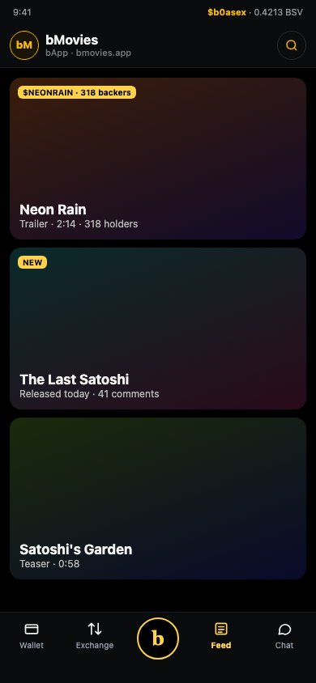

# @bwalletx/connect

Add "Sign in with bWalletX" to a website. Built on the open BRC-100 wallet interface, so every BRC-100 wallet works the same way, with bWalletX first.

The user's wallet signs a one-time challenge from your server with a key derived from its identity key. Your server checks the signature and signs the user in as that identity key. You don't need an API key or an account with us, and nothing passes through bwalletx.com. The only service of ours involved is the encrypted pairing relay (`relay.bwallet.space`), and only when the user signs in from a phone or the web wallet.

The full protocol is described at https://bwalletx.com/connect.md. This package is the same code, packaged.

## Install

```sh
pnpm add @bwalletx/connect @bsv/sdk
```

`@bsv/sdk` (2.2 or later, 2.x or 3.x) is a peer dependency.

## Next.js quick start (App Router)

Works with bWalletX and any other BRC-100 wallet. Set a session secret (32+ characters) in your environment. There is no default: the routes throw without it.

```sh
# .env.local (never commit it)
BWALLETX_SESSION_SECRET=   # e.g. the output of: openssl rand -base64 48
APP_ORIGIN=https://example.com
```

```ts
// lib/bwalletx.ts
import { createBwalletXAuth, pgStore, signInOrLink } from '@bwalletx/connect/next';
import { query } from './db'; // (sql, params) => Promise<{ rows }>

export const auth = createBwalletXAuth({
  origin: process.env.APP_ORIGIN!,
  store: pgStore({ query }),            // or redisStore({ client: upstash })
  // Optional: link the identity key to your user table.
  onVerified: async (identityKey) => {
    const r = await signInOrLink(identityKey, {
      findUserByIdentityKey: async (k) => (await query('select user_id from wallet_links where identity_key = $1', [k])).rows[0]?.user_id ?? null,
      attach: async (uid, k) => void (await query('insert into wallet_links (user_id, identity_key) values ($1, $2)', [uid, k])),
      createUser: async () => (await query('insert into users default values returning id', [])).rows[0].id,
    });
    return { uid: r.userId ?? undefined };
  },
});
```

```ts
// app/api/bwalletx/challenge/route.ts
import { auth } from '@/lib/bwalletx';
export const POST = auth.challenge;
// app/api/bwalletx/verify/route.ts  → export const POST = auth.verify;
// app/api/bwalletx/logout/route.ts  → export const POST = auth.logout;
// app/api/bwalletx/session/route.ts → export const GET = auth.session;
```

```tsx
// any server component or route handler
const session = await auth.getSession(); // { sub: identityKey, uid?, handle?, paymail?, exp } | null
```

The cookie (`bwx_session`) is `HttpOnly; SameSite=Lax; Secure` (Secure when the origin is https), HMAC-SHA256 signed, 7 days by default (`maxAge`). Both POST routes check the `Origin` header against `origin`. `signSession` / `verifySession` are also exported from `@bwalletx/connect/server` if you want the token without the adapter.

Create the nonce table once (a migration): `pgNonceTableSql()` returns the SQL.

## React quick start

```tsx
'use client';
import { BwalletXProvider, useBwalletX } from '@bwalletx/connect/react';

export function Providers({ children }: { children: React.ReactNode }) {
  return (
    <BwalletXProvider
      challengeUrl="/api/bwalletx/challenge"
      verifyUrl="/api/bwalletx/verify"
      logoutUrl="/api/bwalletx/logout"
      sessionUrl="/api/bwalletx/session">
      {children}
    </BwalletXProvider>
  );
}

function Account() {
  const { status, identityKey, handle, connect, disconnect, tip } = useBwalletX();
  if (status !== 'connected') return <button onClick={() => connect()}>Connect wallet</button>;
  return (
    <>
      <span>{handle ?? identityKey?.slice(0, 10)}</span>
      <button onClick={() => tip({ to: 'author@example.com', usd: 0.05 })}>Tip 5¢</button>
      <button onClick={disconnect}>Sign out</button>
    </>
  );
}
```

`useBwalletX()` gives `status` (`idle | restoring | connecting | connected | error`), `identityKey`, `handle`, `paymail`, `wallet` (the BRC-100 `WalletInterface`), `walletId`, `signedIn`, `error`, `wallets`, `connect({ walletId? })`, `disconnect()`, `listWallets()`, `pay`, `tip` and `buyToken`.

`connect()` finds wallets, shows the built-in picker when there is more than one (bWalletX first), shows the pairing QR modal for phones, and signs in through your routes when `challengeUrl` and `verifyUrl` are set. Nothing touches `window` during render, so the provider is safe in server-rendered pages. After a reload the session comes back from `sessionUrl`, but `wallet` stays `null` until the user calls `connect()` again.

## Payments

```ts
import { pay, tip, buyToken } from '@bwalletx/connect';

await pay(wallet, { to: 'alice@example.com', sats: 5000, memo: 'Album' }); // paymail
await pay(wallet, { to: '1Abc...', usd: 1 });                              // address; WhatsOnChain rate, or pass usdPerBsv
const r = await pay(wallet, { to: identityKeyHex, sats: 100 });            // BRC-29; r.remittance goes to the recipient
await buyToken(wallet, { token: '$BOASE', amount: 100, quote: (q) => fetch('/api/quote', { method: 'POST', body: JSON.stringify(q) }).then((x) => x.json()) });
```

Each call makes one `createAction`, and nothing is ever retried. Failures throw a `PaymentError` with a `code` (`BAD_REQUEST`, `RESOLVE_FAILED`, `RATE_FAILED`, `WALLET_REJECTED`, `WALLET_ERROR`, `NOT_SUPPORTED`). When `maybeSent` is true, the wallet may already have broadcast the payment, so check before you ask the user again. Browsers often can't resolve paymails themselves because of CORS, so pass `resolvePaymail` to do it on your server.

**Verify payments on your server.** A txid or BEEF that comes back to the page is only what the page was told: a
browser extension, a modified page or (before 0.5.2) a parent frame posing as the wallet can return a fake one.
Deliver nothing until your server has checked the payment:

```ts
import { verifyPayment } from '@bwalletx/connect/server';

const r = await verifyPayment({
  tx: body.tx ?? body.txid,                       // Atomic BEEF / BEEF / raw hex, or a txid (fetched from WhatsOnChain)
  expected: [{ address: SELLER_ADDRESS, satoshis: price }], // or { script: hex, satoshis }
  requireSeen: true,                              // status from WhatsOnChain; or status: 'arc', arcUrl, arcApiKey
});
```

Every expected output has to be matched by a different output that carries at least the expected amount. Otherwise `verifyPayment` throws a `PaymentVerificationError` with a `code` (`OUTPUT_MISSING`, `TX_NOT_FOUND`, `NOT_SEEN`, `REJECTED`, `SPV_FAILED`, `BAD_TX`, `NETWORK`). Pass `spv: chainTracker` to check the merkle proofs in a BEEF as well.

## Wallets and the picker

`discoverWallets()` lists everything it can find, with bWalletX first:

- every wallet that announces itself through BRC-100 discovery (bWalletX, Yours, Metanet and others)
- the in-app browser's `window.CWI`
- desktop wallets on localhost ports 3321 and 3301 (only with `probeLocal: true`)
- phone pairing (`pairing: pairingModal()`)
- any adapters you add in `extra`

`pickWallet(list)` shows the picker. `pairingModal()` returns `PairingOptions` that draw the QR code and match code, so you no longer need your own QR library. On phones and tablets it shows an **Open bWalletX** button (the pairing universal link opens the app) and a web.bwalletx.com fallback instead of a QR; pass `mode: 'qr'` or `'app'` to force one.

## Migrating from HandCash Connect

1. Keep your HandCash login for now and put it behind the same picker:
   ```ts
   import { handcashAdapter } from '@bwalletx/connect';
   const handcash = handcashAdapter({
     login: () => myExistingHandCashLogin(), // resolves { handle, paymail? } once signed in
     pay: (req) => fetch('/api/handcash/pay', { method: 'POST', body: JSON.stringify(req) }).then((r) => r.json()),
   });
   <BwalletXProvider extraWallets={[handcash]} ... />
   ```
   **This adapter is transitional.** It wraps your own HandCash code; this package does not import any HandCash SDK. HandCash announced BRC-100 support in October 2026. Once that ships, HandCash shows up as an ordinary BRC-100 wallet and you can delete the adapter.
2. Let existing users link their wallet. When someone already signed in with HandCash connects bWalletX, call `signInOrLink(identityKey, { currentUserId, ... })` (or `linkIdentity`) in `onVerified`. This links the identity to their existing account instead of creating a new one. If the identity is already linked to someone else, `IdentityLinkConflictError` turns into a 409 response.
3. Replace HandCash payment calls with `pay` / `tip` / `buyToken`, and check them on the server with `verifyPayment` instead of HandCash payment webhooks.
4. Remove the adapter when your users have moved over.

## The button

`<bwalletx-signin>` is the standard "Sign in with bWalletX" button: a web component with no dependencies (Shadow DOM), plus a React wrapper. It is the gold button from bit-sign's sign-in card.

```html
<script src="https://unpkg.com/@bwalletx/connect@0.2.0"></script>
<bwalletx-signin challenge-url="/auth/bwalletx/challenge" verify-url="/auth/bwalletx/verify"></bwalletx-signin>
<script>
  document.addEventListener('bwalletx-signed-in', (e) => location.assign('/'));
</script>
```

With a bundler: `import '@bwalletx/connect/element'` registers the element. In React:

```tsx
import { BwalletxSignin } from '@bwalletx/connect/react';

<BwalletxSignin challengeUrl="/auth/bwalletx/challenge" verifyUrl="/auth/bwalletx/verify" onSignedIn={(d) => console.log(d.identityKey)} />
```

| Attribute | Values |
|---|---|
| `size` | `lg` (default), `md`, `sm`, `icon` |
| `theme` | `gold` (default), `dark`, `light` |
| `label` | `signin` (default), `continue`, `connect` |
| `brand` | `bWalletX` (default), `bWallet` (store edition) |
| `subtitle` | `on`, `off`, or your own text. Default "also works with bWallet" on lg/md |
| `full-width`, `loading`, `disabled` | flags |
| `challenge-url`, `verify-url` | run the sign-in flow on click: POST `{ identityKey }`, then POST `{ identityKey, nonce, signature }` |
| `get-url`, `web-url` | where "Get bWalletX" and the web wallet link go (bwalletx.com/get, web.bwalletx.com) |
| `href` | navigate on click instead |
| `authorize-url`, `client-id`, `redirect-uri`, `scope` | OAuth 2.1 redirect with S256 PKCE (verifier, state and nonce in `sessionStorage["bwalletx:oauth"]`). For auth.bwalletx.com, which is planned and not live yet |

Events (bubbling, composed): `bwalletx-signin` on every click (call `preventDefault()` to run your own flow instead), `bwalletx-signed-in` with `{ identityKey, method, nonce, signature, response }`, `bwalletx-not-found` (the button then shows "Get bWalletX" and a web wallet link), `bwalletx-error` with `{ error }`.

Without `challenge-url`, `href` or `authorize-url` the button only fires `bwalletx-signin`. The built-in flow uses the extension or in-app browser only. For phone pairing, listen for `bwalletx-signin`, call `preventDefault()`, and call `signInWithBwalletX` with `pairing` as shown above.

SVG files, and an HTML/CSS version with no JavaScript, are in `assets/`. All variants: `examples/buttons.html`. Placement, sizes and do/don't: [BRAND.md](./BRAND.md). The names and logo are not MIT licensed: [TRADEMARKS.md](./TRADEMARKS.md).

## Server

```ts
import { createChallenge, verifySignIn, originAllowed, memoryStore } from '@bwalletx/connect/server';

const ORIGIN = 'https://example.com'; // your site, from config. Never from the request.
const store = memoryStore();          // dev only. See "Nonce store" below.

// POST /auth/bwalletx/challenge   body: { identityKey }
app.post('/auth/bwalletx/challenge', async (req, res) => {
  if (!originAllowed(req.get('origin'), ORIGIN)) return res.status(403).end();
  try {
    res.json(await createChallenge({ origin: ORIGIN, identityKey: req.body?.identityKey, store }));
  } catch (e) {
    res.status(400).json({ error: (e as Error).message });
  }
});

// POST /auth/bwalletx/verify   body: { identityKey, nonce, signature }
app.post('/auth/bwalletx/verify', async (req, res) => {
  if (!originAllowed(req.get('origin'), ORIGIN)) return res.status(403).end();
  const identityKey = await verifySignIn({ origin: ORIGIN, store, ...req.body });
  if (!identityKey) return res.status(401).json({ error: 'That signature was not accepted. Start again.' });
  // Find or create the user keyed on identityKey, then start your own session.
  res.json({ identityKey });
});
```

`verifySignIn` returns the identity key (66 lowercase hex characters) or `null`. It refuses a nonce that was already used, has expired (2 minutes), was issued for another origin or another identity key, or whose signature doesn't verify.

The text the wallet signs:

```
Sign in to example.com with bWallet

This proves you hold this wallet. It does not spend anything.

Origin: https://example.com
Nonce: <nonce>
Expires: <ISO time>
```

It is signed with BRC-100 `createSignature`, protocol `[2, 'bwallet sign in']`, keyID = the nonce, counterparty `'anyone'`. bChat and bit-sign use the same format.

### Nonce store

```ts
interface NonceStore {
  put(nonce: string, c: PendingChallenge): Promise<void> | void;
  take(nonce: string): Promise<PendingChallenge | null> | PendingChallenge | null; // read AND delete
}
```

`take` must read and delete in one step. `verifySignIn` calls it before checking anything else, so each nonce gets exactly one attempt.

`memoryStore()` keeps challenges in the process. It is lost on restart and isn't shared between processes or serverless instances, so it prints a warning the first time it is used. If you leave out `store`, a shared in-memory store is used and you get the same warning. In production it warns louder. Use one of the built-in shared stores, which need no driver dependency because you pass your own client:

- `redisStore({ client })`: Upstash, Vercel KV or node-redis as they are, or ioredis with `flavor: 'ioredis'`. It uses `GETDEL`, so you need Redis 6.2 or later.
- `pgStore({ query })`: any `(sql, params)` function (node-postgres, postgres.js, Neon). It deletes each nonce with `DELETE ... RETURNING`, and `pgNonceTableSql()` gives you the table.

Also rate-limit the challenge route per IP. It is unauthenticated.

## Browser

```ts
import { signInWithBwalletX, renderButton } from '@bwalletx/connect';
import QRCode from 'qrcode'; // any QR library

const panel = document.getElementById('bwx-pair')!;

renderButton('#bwx-button', {
  onClick: async (button) => {
    button.disabled = true;
    try {
      const r = await signInWithBwalletX({
        challenge: (identityKey) => post('/auth/bwalletx/challenge', { identityKey }),
        pairing: {
          onLink: async (link) => {
            panel.innerHTML = ``;
          },
          onCode: (code) => panel.append(`Check bWalletX shows ${code}, then tap Connect.`),
        },
      });
      await post('/auth/bwalletx/verify', { identityKey: r.identityKey, nonce: r.nonce, signature: r.signature });
      // r.method is 'extension', 'in-app' or 'pairing'
    } finally {
      button.disabled = false;
    }
  },
});

async function post(url: string, body: unknown) {
  const res = await fetch(url, { method: 'POST', headers: { 'content-type': 'application/json' }, body: JSON.stringify(body) });
  if (!res.ok) throw new Error((await res.json().catch(() => ({}))).error ?? `HTTP ${res.status}`);
  return res.json();
}
```

`signInWithBwalletX` finds a wallet in this order:

1. The bWalletX Chrome extension: BRC-100 discovery, `rdns` `com.bwalletx.extension`. Gives `method: 'extension'`.
2. The bWalletX app's in-app browser: `rdns` `space.bwallet.mobile`, or `window.CWI` if nothing announced. Gives `method: 'in-app'`. Note that `window.CWI` can also be set by another wallet.
3. A pairing stored by an earlier sign-in on this browser (`reusePairing`, default on).
4. A new pairing, if you passed `pairing`. Show the link as a QR code for the phone, and as text the user can paste into web.bwalletx.com. Both screens show the same 4-digit code. Gives `method: 'pairing'`.

If none of these works, it throws an error with `code: 'NOT_FOUND'`.

It returns `{ identityKey, signature, nonce, method, wallet }`. Post the first three to your verify route. `wallet` is a BRC-100 `WalletInterface` you can keep using.

### Lower-level pieces

| Export | What it does |
|---|---|
| `findBwalletX(ms?)` | The extension or in-app wallet, or `null`. |
| `discoverBwalletX(ms?)` | The same, plus `method` and `rdns`. |
| `pairBwalletX({ onLink, onCode, storage?, signal?, socket?, origin?, relay? })` | Pair over the relay. Resolves with a wallet when the user taps Connect. |
| `restorePairing({ storage? })` | The wallet from a stored pairing, or `null`. It connects on the first call. |
| `clearPairing()` | Delete the stored pairing without telling the wallet. |
| `wallet.close()` / `wallet.forget()` | On a paired wallet: close the socket, or unpair and delete it. |
| `connectBwalletX(opts)` | The wallet-finding half of `signInWithBwalletX`. |
| `renderButton(el, { onClick?, subtitle? })` | Draws the gold button into `el`. |
| `inOrder(handler)` | Wraps an async WebSocket handler so frames run one at a time, in order. |

### Pairing storage

The pairing is saved under `bwalletx.connect.pairing.v1` in `localStorage` by default. It holds a random pairing key (not a wallet key), the wallet's pairing public key, the channel, and the message counters. To store it elsewhere, pass `storage` (anything with `getItem`, `setItem` and `removeItem`, sync or async). Pass `storage: null` to keep it in memory only.

### Frame order

The phone sends a plain `hello` and then, as soon as the user taps Connect, an encrypted `ready`. An async `onmessage` handler that is still deriving the key from `hello` when `ready` arrives drops `ready`, and pairing never finishes. This package handles frames one at a time in arrival order (`inOrder`). `test/pair.test.ts` reproduces the race.

## One script tag

```html
<script src="https://unpkg.com/@bwalletx/connect/dist/bwalletx-connect.global.js"></script>
<script>
  const { signInWithBwalletX, renderButton } = window.bWalletXConnect;
</script>
```

This build includes `@bsv/sdk` (about 125 KB minified). The server functions are not in it.

## bApp shell

`@bwalletx/connect/shell` gives every bApp the same 5-slot bar as the bWalletX dock: **Wallet · Exchange · (b) · Feed · Chat**, each scoped to your app. Your app's Home and sections live in a drawer opened from the app icon, top left. On the web the package draws the bar; inside bWalletX it hides it and the wallet's native dock drives your app instead.



1. Serve `/.well-known/bapp.json` (schema: [`schema/bapp.schema.json`](schema/bapp.schema.json), sample: [`examples/bapp.bmovies.json`](examples/bapp.bmovies.json)). All paths are same-origin; a slot you don't use is `"enabled": false` (shown greyed out, never hidden).
2. Add the elements:

```html
<bwalletx-topbar drawer="sections"></bwalletx-topbar>
<main>…</main>
<bwalletx-drawer id="sections"></bwalletx-drawer>
<bwalletx-bar active="feed"></bwalletx-bar>
<script type="module">
  import { defineBappShell, loadManifest, applyManifest, startShellBridge } from '@bwalletx/connect/shell';
  defineBappShell();
  const manifest = await loadManifest();      // fetches and validates /.well-known/bapp.json
  applyManifest(manifest);
  startShellBridge({ manifest });             // inside bWalletX: hide the bar, follow the wallet's dock
</script>
```

React:

```tsx
import { BappTopbar, BappDrawer, BappBar } from '@bwalletx/connect/shell/react';
<BappTopbar manifest={m} drawer="sections" />
<BappDrawer id="sections" manifest={m} manualNavigation onNavigate={(d) => router.push(d.path!)} />
<BappBar manifest={m} active={slot} manualNavigation onNavigate={(d) => router.push(d.path!)} />
```

No bundler: `<script src="https://unpkg.com/@bwalletx/connect/dist/bwalletx-shell.global.js">` registers the elements and exposes `window.bWalletXShell`.

| Element | Attributes | Events (bubble, composed) |
|---|---|---|
| `<bwalletx-bar>` | `active`, `in-wallet` (`auto`/`true`/`false`), `navigate="manual"`; property `manifest` | `bapp-navigate {slot, path}` (cancelable), `bapp-active {slot}`, `bapp-b-press`, `bapp-b-hold {phase}` |
| `<bwalletx-topbar>` | `title`, `subtitle`, `drawer` (id), `menu="true"`, `strip="off"`, `in-wallet`; slots `strip-left`, `strip-right`, `tools` | `bapp-menu`, `bapp-close`, `bapp-drawer-toggle` (cancelable) |
| `<bwalletx-drawer>` | `open`, `current` (path), `in-wallet`, `navigate="manual"` | `bapp-navigate {path}` (cancelable), `bapp-close` |

`bapp-navigate` goes to the manifest path with `location.assign` unless you call `preventDefault()` or set `navigate="manual"`, so SPAs route themselves. Inside the wallet, ☰ and ✕ appear in the top bar and the drawer gets "Back to bWalletX".

API: `validateManifest(json)` → `{ok, manifest, errors}`, `parseManifest`, `loadManifest(path?)`, `isSameOriginPath`, `slotPath`, `detectWalletUA(ua?)`, `walletState()`, `ShellBridge` / `startShellBridge({manifest, walletOrigins?})`, `defineBappShell()`, `applyManifest(m)`, `TOKENS`. The wallet message protocol is in [docs/SHELL-PROTOCOL.md](docs/SHELL-PROTOCOL.md). Demo: `examples/shell.html` (after `pnpm build`; `?wallet=1` shows the in-wallet top bar, `#drawer` opens the drawer).

## Limits

- Sign-in proves the identity key and nothing else: no handle, paymail or name. Use `onVerified` to look them up and add them yourself.
- The identity key is the same on every site that uses this method, so two sites can tell it is the same wallet.
- `relay.bwallet.space` is run by The Bitcoin Corporation. It has no published uptime guarantee and allows about 60 frames a minute per channel.
- There is no hosted sign-in page or OAuth-style redirect (auth.bwalletx.com is planned). You run the routes yourself; `@bwalletx/connect/next` gives you ready-made ones.

## Testing

```sh
pnpm test        # unit tests: challenge/verify, frame order, reload, sign-in paths
pnpm test:live   # pairs with a simulated phone over the real relay.bwallet.space
```

To test your own server without a wallet, sign with `new ProtoWallet(PrivateKey.fromRandom()).createSignature(...)` using the same arguments. That is the signature bWalletX makes.

`src/protocol.ts` is copied unchanged from bWalletX `src/pair/protocol.ts`. Don't edit it; the app must understand every byte.

## License

MIT
